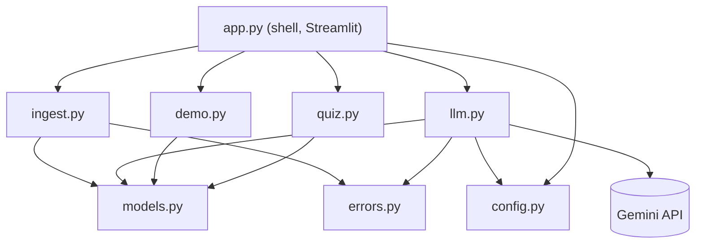
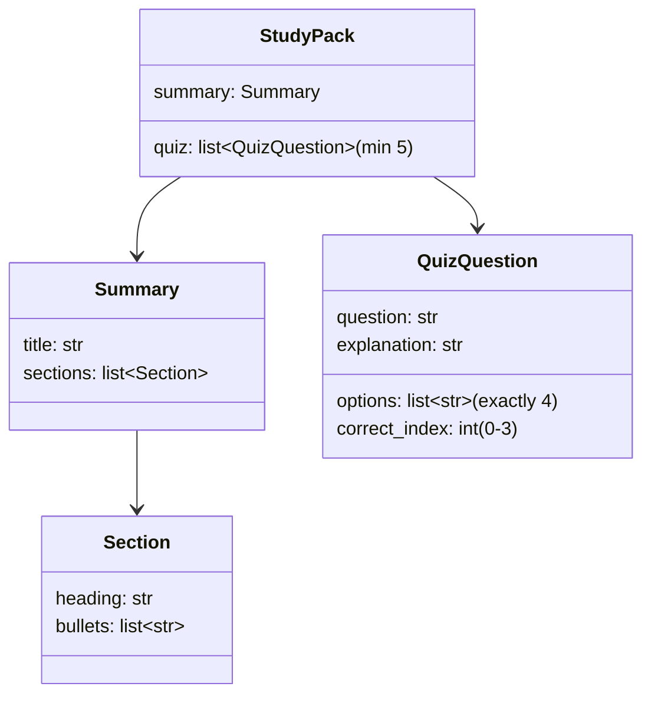
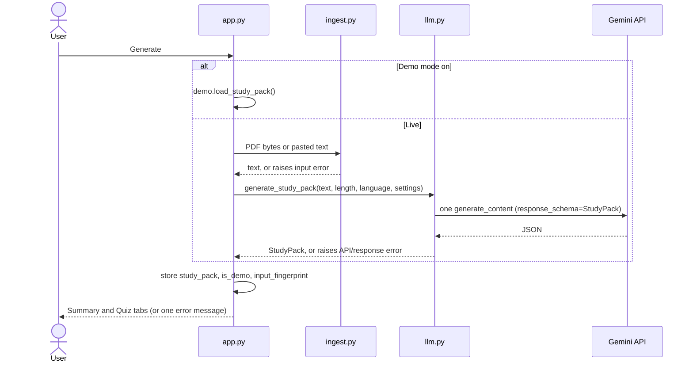
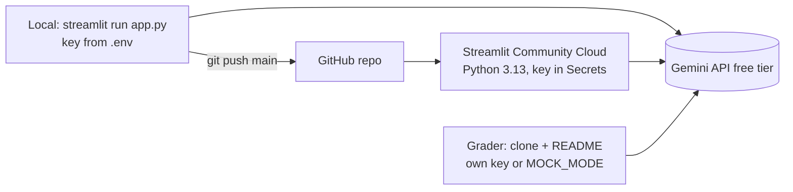

# Architecture Spine — AI Study Buddy

## Design Paradigm

**Functional core, imperative shell.** `app.py` is the only shell: it draws the Streamlit page, owns session state and turns errors into messages. Everything else is a plain-Python core module that takes values in and returns values out, with no Streamlit import. The flow inside the core is a short pipeline: **ingest → generate → check**.

| Layer | Modules | May import |
| --- | --- | --- |
| Shell | `app.py` | all core modules, `streamlit` |
| Pipeline | `ingest.py`, `llm.py`, `demo.py`, `quiz.py` | `models.py`, `errors.py`, `config.py`, `prompts/` files, their own library (`pypdf`, `google-genai`) |
| Foundation | `models.py`, `errors.py`, `config.py` | `pydantic`, `python-dotenv`, standard library |



Arrows point one way only. Pipeline modules never import each other or `app.py`.

## Invariants & Rules

### AD-1 — Streamlit only in the shell

- **Binds:** all
- **Prevents:** UI calls inside logic, which makes the core untestable without a browser and spreads state handling across files.
- **Rule:** Only `app.py` imports `streamlit`. Core modules take and return plain Python values or `models.py` types.

### AD-2 — One Gemini request per Generate [ADOPTED]

- **Binds:** FR-7, FR-8, PRD §9, PRD OQ 2
- **Prevents:** a summary and a quiz built from different calls drifting apart, and double use of the free-tier quota.
- **Rule:** Each Generate makes exactly one `generate_content` call, which returns one `StudyPack` JSON (Summary and Quiz together) using `response_mime_type="application/json"` and `response_schema=StudyPack`. No automatic retries; the user presses Generate again.

### AD-3 — `StudyPack` is the single shared data shape

- **Binds:** FR-7, FR-8, FR-9, FR-10, FR-12
- **Prevents:** live output, demo output and tests each assuming a different structure.
- **Rule:** `models.py` defines `StudyPack` once (Pydantic). Live and demo output are both validated through it before they reach `app.py`.



### AD-4 — `llm.py` is the only Gemini gateway

- **Binds:** FR-6, FR-7, FR-8
- **Prevents:** several places building clients, choosing models or wording prompts differently.
- **Rule:** Only `llm.py` creates `genai.Client` and calls the API. Its public entry point is `generate_study_pack(text, length, language, settings) -> StudyPack`. The model id and API key come from the `Settings` value (AD-9). A missing key raises `MissingApiKey` before any call.

### AD-5 — Typed errors, mapped to messages in one place

- **Binds:** FR-3, FR-4, UX State Patterns
- **Prevents:** raw `pypdf` or `google.genai` exceptions reaching the user, and the same failure showing different messages.
- **Rule:** Core modules raise only subclasses of `StudyBuddyError` from `errors.py`: `EmptyInput`, `EmptyFile`, `NotPdf`, `NoExtractableText`, `MissingApiKey`, `RateLimited` (API code 429), `GeminiUnavailable` (timeout, network, other `errors.APIError`), and `BadModelResponse` (JSON or schema validation failed). `app.py` maps each type to exactly one message from EXPERIENCE.md State Patterns.

### AD-6 — Validate input before any API call

- **Binds:** FR-1, FR-2, FR-3, FR-4
- **Prevents:** wasting quota on empty or unreadable input, and `llm.py` receiving input it can't use.
- **Rule:** `ingest.py` turns an uploaded PDF or pasted text into one non-empty `str`, or raises. Whitespace-only text counts as empty. `llm.py` is only called with the output of `ingest.py`.

### AD-7 — Session state has fixed keys and fixed writers

- **Binds:** FR-9, FR-10, FR-12, UX stale-results state
- **Prevents:** quiz interaction triggering a new generation, and handlers overwriting each other's state across Streamlit reruns.
- **Rule:** `app.py` uses exactly these `st.session_state` keys:

  | Key | Written by |
  | --- | --- |
  | `study_pack`, `is_demo`, `input_fingerprint` | Generate handler only |
  | `quiz_answers`, `quiz_checked` | Quiz form and Try again only; cleared by Generate |

  `input_fingerprint` is a hash of source text + length + language + demo flag; the stale-results note shows when the current fingerprint differs from the stored one. Nothing is written to disk.

### AD-8 — Prompts are files with a change log

- **Binds:** FR-5, FR-6, FR-7, PRD §9
- **Prevents:** prompt text scattered through code, and prompt changes that a grader can't trace.
- **Rule:** Prompt templates live in `prompts/` as text files, filled with the Length word range and the Output Language. The JSON schema is passed only through `response_schema`, never repeated in the prompt. Every prompt change gets an entry in `PROMPTS.md` saying what changed and why.

### AD-9 — `config.py` is the only reader of secrets and settings

- **Binds:** FR-12, PRD §11
- **Prevents:** the API key being read in several ways (and committed or shown by mistake), and the local and cloud setups behaving differently.
- **Rule:** `config.load_settings(secrets)` returns a `Settings` value. `app.py` passes `st.secrets` in as a plain mapping, so `config.py` never imports Streamlit. `GEMINI_API_KEY` comes from that mapping when present, otherwise from the environment (`.env` loaded with `python-dotenv`). `Settings` also carries `MOCK_MODE` (default for the demo toggle) and `GEMINI_MODEL` (overrides the model id). The key is passed to `genai.Client(api_key=...)` and is never logged or displayed. `.env` and `.streamlit/secrets.toml` are gitignored; `.env.example` is committed.

### AD-10 — Demo mode skips the whole pipeline

- **Binds:** FR-12
- **Prevents:** demo output that looks real, or demo runs that still need a key or call the API.
- **Rule:** When the demo toggle is on, Generate calls `demo.load_study_pack()`, which reads `demo/study_pack.json` and validates it through `StudyPack`. `ingest.py` and `llm.py` are not called. `is_demo=True` drives the UX demo banner.

### AD-11 — Tests never call the live API

- **Binds:** PRD §10, PRD §7 (cost)
- **Prevents:** tests that burn free-tier quota, fail without network, or depend on a key.
- **Rule:** `pytest` tests cover `ingest.py`, `quiz.py`, `models.py` and the `llm.py` response parsing and error translation, with `llm`'s network call monkeypatched. Sample inputs live in `test_data/`.

## Consistency Conventions

| Concern | Convention |
| --- | --- |
| Naming | Modules and functions `snake_case`; classes `PascalCase`; identifiers and comments in English. |
| Length / language values | `Length` enum `short` · `medium` · `long`; `Language` enum `en` · `no`; both defined in `models.py`. UI labels map to these. |
| Word ranges | One table in `models.py`: short `<150`, medium `150–400`, long `400–800` (FR-5). Prompts and tests read it from there. |
| Word count | `len(text.split())` over the summary's headings and bullets, computed by the app, never taken from the model. |
| Quiz checking | `quiz_answers` is a `list[int \| None]`, one chosen option index per question in quiz order (`None` = unanswered). `quiz.py` compares each to `correct_index` and returns per-question results and the score. |
| Errors | Raise `errors.py` types only; no bare `except:`; log the original exception with `print` before translating it. |
| Secrets | Only `config.py` touches `GEMINI_API_KEY`. |

## Stack

| Name | Version |
| --- | --- |
| Python | 3.13 |
| streamlit | 1.67.0 |
| google-genai | 3.3.0 |
| pypdf | 7.1.0 |
| pydantic | 2.14.3 |
| python-dotenv | 1.2.4 |
| pytest (dev) | 9.2.0 |
| Gemini model | `gemini-3.5-flash-lite` (free tier, stable) |

Dependencies are pinned with `==` in `requirements.txt`.

## Structural Seed

```text
G65-ibrahim/
  app.py                 # shell: page, session state, error → message mapping
  ingest.py              # PDF / pasted text → str (AD-6)
  llm.py                 # Gemini gateway → StudyPack (AD-2, AD-4)
  quiz.py                # answer checking and score
  demo.py                # loads demo/study_pack.json (AD-10)
  models.py              # StudyPack, Length, Language, word ranges (AD-3)
  errors.py              # StudyBuddyError hierarchy (AD-5)
  config.py              # key, MOCK_MODE, GEMINI_MODEL (AD-9)
  prompts/               # prompt templates (AD-8)
  demo/study_pack.json   # saved example output
  test_data/             # Norwegian PDF, English PDF, mixed text, scanned PDF
  tests/                 # pytest, no live API (AD-11)
  PROMPTS.md             # prompt change log
  README.md
  requirements.txt
  .env.example
  .streamlit/            # secrets.toml (gitignored)
```

### Generate flow



### Deployment & environments



Two environments only, local and Community Cloud, both running the same code. There is no CI, no database and no logging service: errors are printed to the console or the Community Cloud log.

## Capability → Architecture Map

| Capability / Area | Lives in | Governed by |
| --- | --- | --- |
| FR-1 to FR-4 Course Material ingestion and validation | `ingest.py` | AD-5, AD-6 |
| FR-5, FR-6 Length and Output Language | `models.py`, `prompts/`, `llm.py` | AD-4, AD-8, conventions |
| FR-7, FR-8 Summary and Quiz generation | `llm.py`, `models.py` | AD-2, AD-3, AD-4 |
| FR-9 Quiz answers and results | `quiz.py`, `app.py` | AD-3, AD-7 |
| FR-10, FR-11 Results UI and loading | `app.py` | AD-1, AD-7, UX spines |
| FR-12 Demo mode | `demo.py`, `config.py`, `app.py` | AD-9, AD-10 |
| PRD §9 Prompt engineering | `prompts/`, `PROMPTS.md` | AD-8 |
| PRD §10 Testing | `tests/`, `test_data/` | AD-11 |
| PRD §11 Secrets and deployment | `config.py`, `requirements.txt` | AD-9, deployment seed |

## Deferred

- **Word-range miss note and pasted-text length cap** (PRD feedback 4.1/4.5): neither is in the PRD or UX. Revisit if real material is too long for the model or summaries miss their ranges in testing.
- **Caching results** (`st.cache_data`): not needed with one request per Generate; revisit if rate limits hit during demos.
- **Flashcards and per-subject storage (SQLite)**: PRD stretch goals. They would add a module next to `quiz.py` and a storage module behind the shell, without changing the existing ADs.
- **Multi-user accounts**: out of scope (PRD §5).
- **CI pipeline**: tests run locally with `pytest`; add GitHub Actions only if time allows.
