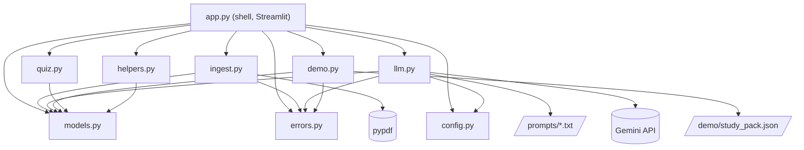
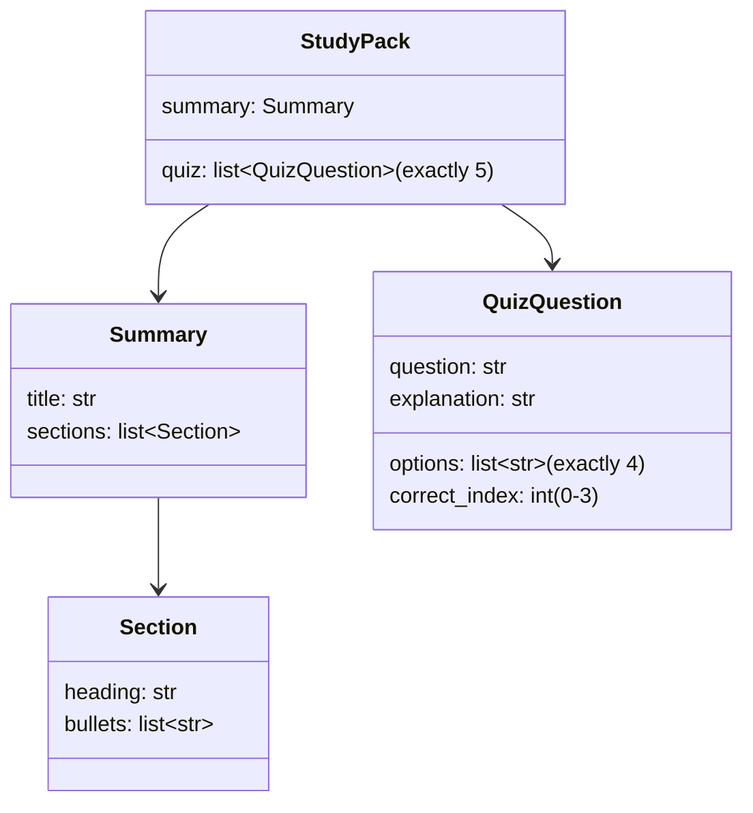
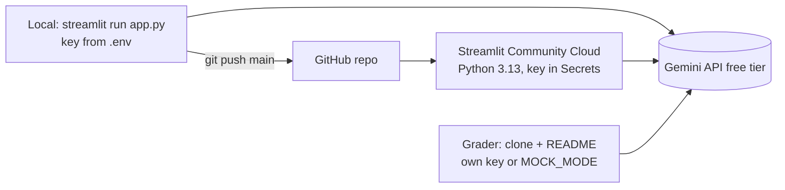

# Architecture Spine — AI Study Buddy

## Design Paradigm

**Functional core, imperative shell.** `app.py` is the only shell: it draws the Streamlit page, owns session state and turns errors into messages. Everything else is a plain-Python core module that takes values in and returns values out, with no Streamlit import. The flow inside the core is a short pipeline: **ingest → generate → check**.

| Layer | Modules | May import |
| --- | --- | --- |
| Shell | `app.py` | all core modules, `streamlit` |
| Pipeline | `ingest.py`, `llm.py`, `demo.py`, `quiz.py` | `models.py`, `errors.py`, own library (`pypdf`; `google-genai` + `httpx2` in `llm.py`); `llm.py` also `config.py` and `prompts/` files; `demo.py` also `demo/study_pack.json` |
| Foundation | `models.py`, `errors.py`, `config.py`, `helpers.py` | `pydantic`, `python-dotenv`, standard library; `helpers.py` may import `models.py` |



Arrows point one way only. Pipeline modules never import each other or `app.py`.

**Staging rule:** a story may ship part of an AD's list (some error messages, some fingerprint inputs) when a later, named story completes it. The finished app must match every AD in full.

## Invariants & Rules

### AD-1 — Streamlit only in the shell

- **Binds:** all
- **Prevents:** UI calls inside logic, which makes the core untestable without a browser and spreads state handling across files.
- **Rule:** Only `app.py` imports `streamlit`. Core modules take and return plain Python values or `models.py` types.

### AD-2 — One Gemini request per Generate [ADOPTED]

- **Binds:** FR-7, FR-8, PRD §9, PRD OQ 2
- **Prevents:** a summary and a quiz built from different calls drifting apart, and double use of the free-tier quota.
- **Rule:** Each Generate makes exactly one `generate_content` call, which returns one `StudyPack` JSON (Summary and Quiz together) using `response_mime_type="application/json"` and `response_schema=StudyPack` (reference: the python-genai README, not the Interactions API). No automatic retries; the user presses Generate again.

### AD-3 — `StudyPack` is the single shared data shape

- **Binds:** FR-7, FR-8, FR-9, FR-10, FR-12
- **Prevents:** live output, demo output, tests and UI each assuming a different structure or question count.
- **Rule:** `models.py` defines `StudyPack` once (Pydantic). The quiz has **exactly 5** questions. Live and demo output are both validated through it before they reach `app.py`, and `app.py` always holds a `StudyPack` instance, never a dict.



### AD-4 — `llm.py` is the only Gemini gateway

- **Binds:** FR-6, FR-7, FR-8, PRD §7 (performance)
- **Prevents:** several places building clients, choosing models or wording prompts differently; requests that hang forever; tests that can't find the network seam.
- **Rule:**
  - Only `llm.py` creates `genai.Client`, with `http_options=HttpOptions(timeout=60_000)` (milliseconds).
  - The only function that touches the network is `_call_gemini(prompt: str, settings: Settings) -> str | None`. It makes the raw SDK call, returns `response.text` (which is `None` for a blocked reply), and translates nothing: SDK and `httpx2` exceptions propagate.
  - The public entry point `generate_study_pack(text, length, language, settings) -> StudyPack` owns everything else:
    - it raises `MissingApiKey` before any call when `settings.api_key` is `None`;
    - it builds the prompt and calls `_call_gemini`;
    - it translates every exception per AD-5;
    - it maps `None` or empty text to `BadModelResponse`;
    - it validates with `StudyPack.model_validate_json(...)`.
  - Tests monkeypatch `_call_gemini` to return text or `None`, or to raise SDK exceptions.

### AD-5 — Typed errors, mapped to messages in one table

- **Binds:** FR-3, FR-4, UX State Patterns
- **Prevents:** raw `pypdf`, `google.genai` or `httpx2` exceptions reaching the user; the same failure showing different messages; stories editing messages in different places.
- **Rule:** Core modules raise only subclasses of `StudyBuddyError` from `errors.py`. `app.py` holds one `ERROR_UI` table mapping each type, by exact type, to a `(style, text)` pair:
  - `style` is the string `"error"` or `"warning"`;
  - texts come from EXPERIENCE.md State Patterns;
  - later stories change messages only in this table.

  The table has two extra rows:
  - a fallback row for any `StudyBuddyError` not yet mapped;
  - a last-resort row for any other exception: "Something went wrong. Try Generate again."

  | Error type | Raised by | Cause |
  | --- | --- | --- |
  | `EmptyInput` | `ingest` | Active source has nothing, or text is whitespace-only |
  | `EmptyFile` | `ingest` | Uploaded file is 0 bytes |
  | `NotPdf` | `ingest` | No `.pdf` extension, or bytes don't start with `%PDF` |
  | `UnreadablePdf` | `ingest` | Encrypted PDF that `decrypt("")` can't open (`FileNotDecryptedError`), or any other exception while reading the PDF |
  | `NoExtractableText` | `ingest` | Extracted text is whitespace-only (scanned PDF) |
  | `MissingApiKey` | `llm` | No key in `Settings` (absent, empty or whitespace) |
  | `InvalidApiKey` | `llm` | `errors.APIError` with code 400 and reason `API_KEY_INVALID` (checked before the next row) |
  | `RateLimited` | `llm` | `errors.APIError` with code 429 |
  | `MaterialRejected` | `llm` | Any other `errors.APIError` with code 400 (e.g. input too large) |
  | `GeminiUnavailable` | `llm` | Other `errors.APIError`, or any `httpx2.TransportError` (timeouts, connection and read errors) |
  | `BadModelResponse` | `llm`, `demo` | Empty or blocked reply, invalid JSON, or `StudyPack` validation failure |

  The original exception is printed to the console before translation.

### AD-6 — Validate input before any API call

- **Binds:** FR-1, FR-2, FR-3, FR-4
- **Prevents:** wasting quota on empty or unreadable input; builders disagreeing on what `ingest` receives or who reports "no input".
- **Rule:** One entry point, `ingest.read_material(source: Source, pdf_name: str | None, pdf_bytes: bytes | None, text: str | None) -> str`. `source` is the active tab (`Source.PDF` or `Source.TEXT`); `app.py` passes the raw widget values. Checks run in the order of the AD-5 table, and the function returns one non-empty `str` or raises. For an encrypted PDF it first tries `decrypt("")`, because owner-password-only PDFs are still readable. Any exception from `pypdf` becomes `UnreadablePdf`. `llm.py` is only called with this output.

### AD-7 — Session state has fixed keys and fixed writers

- **Binds:** FR-9, FR-10, FR-12, UX stale-results and caption states
- **Prevents:** quiz interaction triggering a new generation; stale radio choices on a new quiz; a failed Generate wiping good results; captions contradicting the results.
- **Rule:**

  | App key | Type | Written by |
  | --- | --- | --- |
  | `study_pack` | `StudyPack \| None` | Generate, only after a `StudyPack` is obtained |
  | `is_demo`, `input_fingerprint`, `generated_with` (`length`, `language`) | as named | Generate, same moment |
  | `generation_id` | `int` | Generate, incremented on success |
  | `is_running` | `bool` | Generate button `on_click` sets `True`; the pipeline block sets `False` |
  | `last_error` | `StudyBuddyError \| Exception \| None` | Pipeline block; cleared at the next Generate click |
  | `quiz_answers` | `list[int \| None] \| None` | Check answers; set to `None` by Generate success and Try again |
  | `quiz_checked` | `bool` | Check answers; cleared by Generate success and Try again |
  | `quiz_round` | `int` | Try again increments; Generate success resets to 0 |

  | Widget key | Value |
  | --- | --- |
  | `source_tab` | Tab label ("Upload PDF" / "Paste text"); mapped to `Source` via `models.SOURCE_BY_TAB_LABEL` |
  | `pdf_upload` | `UploadedFile \| None`; `app.py` passes `name` and `getvalue()` bytes |
  | `paste_text` | `str` |
  | `length`, `language` | `Length` / `Language` enum members (radio options), labels via `format_func` |
  | `demo_mode` | `bool`; seeded with `if "demo_mode" not in st.session_state: st.session_state.demo_mode = settings.mock_mode` before the toggle, which gets no `value=` |
  | `q_<generation_id>_<quiz_round>_<i>` | `int \| None`; quiz radio with options `[0, 1, 2, 3]` and a `format_func` showing the option text |

  **Generate mechanism:**
  - The button is drawn with `disabled=is_running` and an `on_click` that clears `last_error` and sets `is_running=True`.
  - On the rerun, the script body at the error-area position runs the pipeline under `st.spinner` while `is_running` is true. It stores either the success keys or `last_error`, sets `is_running=False`, and calls `st.rerun()`.
  - The error area shows `last_error` through `ERROR_UI`.
  - A failed Generate changes no app key except `is_running` and `last_error`.

  The summary caption reads `generated_with`, never the live widgets. Nothing is written to disk.

### AD-8 — Prompts are files with a change log

- **Binds:** FR-5, FR-6, FR-7, PRD §9
- **Prevents:** prompt text scattered through code; prompt and code disagreeing on placeholder names; prompt changes a grader can't trace.
- **Rule:** Prompt templates live in `prompts/` as text files using `string.Template` placeholders `$word_range`, `$language_name` and `$material`, filled with `safe_substitute`. The JSON schema is passed only through `response_schema`, never repeated in the prompt. Every prompt change gets an entry in `PROMPTS.md` saying what changed and why.

### AD-9 — `config.py` is the only reader of secrets and settings

- **Binds:** FR-12, PRD §11
- **Prevents:** a startup crash when no `secrets.toml` exists; the API key read in several ways (and committed or shown by mistake); local and cloud setups behaving differently.
- **Rule:**
  - `app.py` converts `st.secrets` to a plain `dict` inside `try/except` (any exception → `{}`) and passes it to `config.load_settings(secrets: Mapping[str, object]) -> Settings`. `config.py` never imports Streamlit. Values are turned into strings with `str()` before use.
  - `Settings` has three fields:
    - `api_key: str | None`: from `GEMINI_API_KEY` in the mapping, else the environment (`.env` via `python-dotenv`). It is stripped, and an empty value becomes `None`.
    - `model: str`: `GEMINI_MODEL`, default `gemini-3.5-flash-lite`.
    - `mock_mode: bool`: `MOCK_MODE` is `True`, `"true"` or `"1"` (strings case-insensitive).
  - The key is never logged or displayed.
  - `.env` and `.streamlit/secrets.toml` are gitignored; `.env.example` is committed.

### AD-10 — Demo mode skips the whole pipeline

- **Binds:** FR-12
- **Prevents:** demo output that looks real, or demo runs that still need a key or call the API.
- **Rule:** When the demo toggle is on, Generate calls `demo.load_study_pack()`, which reads `demo/study_pack.json` and validates it through `StudyPack` (failure → `BadModelResponse`). `ingest.py` and `llm.py` are not called. `demo.py` also exposes `DEMO_LENGTH` and `DEMO_LANGUAGE`, the settings the example was made with; in demo mode `generated_with` uses these, not the widgets. `is_demo=True` drives the UX demo banner.

### AD-11 — Tests never call the live API

- **Binds:** PRD §10, PRD §7 (cost)
- **Prevents:** tests that burn free-tier quota, fail without network, or depend on a key.
- **Rule:** `pytest` tests cover `ingest.py`, `quiz.py`, `models.py`, `helpers.py`, `demo.py` and `llm.py` (parsing and error translation), with `llm._call_gemini` monkeypatched. Sample inputs live in `test_data/`. The one live call is a manual smoke check in Story 1.3.

### AD-12 — Fingerprint and word count are core helpers

- **Binds:** FR-10, UX stale-results state, UX summary caption
- **Prevents:** the stale-results note being always on or never on because the Generate handler and the per-rerun check hash different things; untestable helpers hidden in the shell.
- **Rule:** `helpers.py` defines:
  - `input_fingerprint(source: Source, raw: bytes | str, length: Length, language: Language, demo: bool) -> str`: SHA-256 hex.
    - **Inputs:** `raw` is the active tab's raw widget value: PDF bytes (`b""` when nothing is uploaded) or pasted text (`""` when empty).
    - **Live mode:** it hashes the UTF-8 string `<source.value>|<length.value>|<language.value>|0|` followed by `raw` (text encoded as UTF-8).
    - **Demo mode:** it hashes only `"demo"`, so editing the input doesn't mark demo results stale.
    - **Callers:** Generate and every rerun call it with the same widget values.
  - `word_count(summary) -> int`: `len(text.split())` over headings and bullets.

## Consistency Conventions

| Concern | Convention |
| --- | --- |
| Naming | Modules and functions `snake_case`; classes `PascalCase`; identifiers and comments in English. |
| Length / language values | `Length` enum `short` · `medium` · `long`; `Language` enum `en` · `no`; `Source` enum `pdf` · `text`; `SOURCE_BY_TAB_LABEL` ("Upload PDF" → `pdf`, "Paste text" → `text`); all in `models.py`. |
| Labels | `models.py` holds `LENGTH_LABELS` (Short/Medium/Long), `LANGUAGE_LABELS` (English/Norsk) and `LANGUAGE_PROMPT_NAMES` (English/Norwegian Bokmål). UI, caption and prompts read from these. Caption format: `<N> words · <length.value> · <LANGUAGE_LABELS[language]>`. |
| Word ranges | One table in `models.py`: short `<150`, medium `150–400`, long `400–800` (FR-5). Prompts and tests read it from there. |
| Quiz checking | `quiz.py` takes a `StudyPack` and `list[int \| None]` (radio values in quiz order) and returns per-question results and the score. |
| Errors | Raise `errors.py` types only; no bare `except:`; print the original exception before translating it. |
| Secrets | Only `config.py` touches `GEMINI_API_KEY`. |
| Streamlit API | Use `width="stretch"`, not the deprecated `use_container_width`. |

## Stack

| Name | Version |
| --- | --- |
| Python | 3.13 |
| streamlit | 1.67.0 |
| google-genai | 3.3.0 |
| pypdf | 7.1.0 |
| pydantic | 2.14.3 |
| python-dotenv | 1.2.4 |
| pytest (dev) | 9.2.0 |
| Gemini model | `gemini-3.5-flash-lite` (free tier, stable) |

These direct dependencies are pinned with `==` in `requirements.txt`. Before the first deploy, the full installed set (including transitive packages such as starlette and uvicorn) is frozen into `requirements.txt` with `pip freeze`. Importing google-genai 3.3.0 on Python 3.13 prints two harmless `SyntaxWarning` lines; the README mentions them.

## Structural Seed

```text
G65-ibrahim/
  app.py                 # shell: page, session state, ERROR_UI (AD-1, AD-5, AD-7)
  ingest.py              # read_material → str (AD-6)
  llm.py                 # Gemini gateway → StudyPack (AD-2, AD-4)
  quiz.py                # answer checking and score
  demo.py                # loads demo/study_pack.json (AD-10)
  helpers.py             # input_fingerprint, word_count (AD-12)
  models.py              # StudyPack, enums, labels, word ranges (AD-3)
  errors.py              # StudyBuddyError hierarchy (AD-5)
  config.py              # load_settings → Settings (AD-9)
  prompts/               # prompt templates (AD-8)
  demo/study_pack.json   # saved example output
  test_data/             # Norwegian PDF, English PDF, mixed text, scanned PDF
  tests/                 # pytest, no live API (AD-11)
  PROMPTS.md             # prompt change log
  README.md
  requirements.txt
  .env.example
  .streamlit/            # secrets.toml (gitignored)
```

### Generate flow

```mermaid
sequenceDiagram
    actor U as User
    participant A as app.py
    participant D as demo.py
    participant I as ingest.py
    participant L as llm.py
    participant G as Gemini API
    U->>A: Generate (on_click: clear last_error, is_running = True)
    A->>A: rerun: button drawn disabled, pipeline block runs under spinner
    alt Demo mode on
        A->>D: load_study_pack()
        D-->>A: StudyPack, or BadModelResponse
    else Live
        A->>I: read_material(source, pdf_name, pdf_bytes, text)
        I-->>A: text, or input error
        A->>L: generate_study_pack(text, length, language, settings)
        L->>G: _call_gemini: one generate_content (timeout 60 s)
        G-->>L: JSON text, None, or SDK/httpx2 exception
        L-->>A: StudyPack, or translated StudyBuddyError
    end
    alt Success
        A->>A: store study_pack, is_demo, input_fingerprint, generated_with; generation_id += 1; reset quiz keys
    else Error
        A->>A: store last_error; other app keys unchanged
    end
    A->>A: is_running = False, st.rerun()
    A-->>U: Summary and Quiz tabs, or one ERROR_UI message
```

### Deployment & operations



- **Environments:** local and Community Cloud, running the same code. Python 3.13 is chosen in Cloud Advanced settings at first deploy (it can't be changed later without redeploying) and confirmed in the build log.
- **Provider:** Gemini free tier only. No throttling: on `RateLimited` the user waits and retries. If the model is deprecated, set `GEMINI_MODEL` to its replacement from Google's models page; no code change.
- **Privacy:** the README states that material is sent to Google Gemini, that the app stores nothing, and that Google uses free-tier input to improve its products.
- **Operations:** no CI, no database, no logging service. Errors are printed to the console or the Community Cloud log.

## Capability → Architecture Map

| Capability / Area | Lives in | Governed by |
| --- | --- | --- |
| FR-1 to FR-4 Course Material ingestion and validation | `ingest.py` | AD-5, AD-6 |
| FR-5, FR-6 Length and Output Language | `models.py`, `prompts/`, `llm.py` | AD-4, AD-8, conventions |
| FR-7, FR-8 Summary and Quiz generation | `llm.py`, `models.py` | AD-2, AD-3, AD-4 |
| FR-9 Quiz answers and results | `quiz.py`, `app.py` | AD-3, AD-7 |
| FR-10 Results UI, caption and stale note | `app.py`, `helpers.py` | AD-1, AD-7, AD-12 |
| FR-11 Loading indicator | `app.py` | AD-7 (`is_running`) |
| FR-12 Demo mode | `demo.py`, `config.py`, `app.py` | AD-9, AD-10 |
| PRD §9 Prompt engineering | `prompts/`, `PROMPTS.md` | AD-8 |
| PRD §10 Testing | `tests/`, `test_data/` | AD-11 |
| PRD §11 Secrets and deployment | `config.py`, `requirements.txt` | AD-9, Deployment & operations |

## Deferred

- **Quiz count checked only after the call**: a reply with the wrong number of questions costs one wasted request (`BadModelResponse`). Accepted as rare.
- **Spine weight**: some pins (labels, widget key names) could move to the stories or the README. Trim after the build if they turn out to be obvious from the code.
- **Word-range miss note and pasted-text length cap** (PRD feedback 4.1/4.5): neither is in the PRD or UX. Oversized input is covered for now by `MaterialRejected`. Revisit if summaries miss their ranges in testing.
- **Caching results** (`st.cache_data`): not needed with one request per Generate; revisit if rate limits hit during demos.
- **Flashcards and per-subject storage (SQLite)**: PRD stretch goals. They would add a module next to `quiz.py` and a storage module behind the shell, without changing the existing ADs.
- **Multi-user accounts**: out of scope (PRD §5).
- **CI pipeline**: tests run locally with `pytest`; add GitHub Actions only if time allows.
